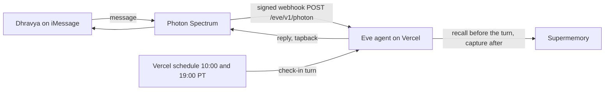

# eve-friend

Juno: a personal friend who texts with Dhravya over iMessage. Built on [Eve](https://eve.dev) (Vercel's agent framework), [Photon](https://photon.codes) Spectrum for iMessage, and [Supermemory](https://supermemory.ai) for memory that survives across conversations and deploys. Deployed on Vercel.

## How it fits together



- `agent/channels/photon.ts`: Eve's built-in Photon iMessage channel. Verifies the Spectrum webhook signature, drops every sender that is not in `FRIEND_IMESSAGE_HANDLES`, and passes the rest to the agent.
- `agent/memory/supermemory.ts`: the Supermemory memory slot. Namespace `eve-friend-juno-v1`, one fixed scope, so memories are shared by every conversation and by the check-in schedule and survive redeploys. Keep both stable.
- `agent/instructions.md`: Juno's persona. Edit this file to change how she talks; redeploy to apply.
- `agent/tools/tapback.ts` and `agent/tools/no_reply.ts`: lets Juno react with tapbacks and stay silent when a reaction, or nothing, is the right answer.
- `agent/schedules/check-in.ts`: twice-daily check-in. Juno reads memory and texts only when there is a reason; otherwise she calls `no_reply`.

## Versions

Eve `1.0.2` with `@supermemory/eve@0.2.0-rc.1` (the `next` tag). The provider README splits by Eve major: `0.1.3` for Eve 0.x, `0.2.0-rc.1` for Eve 1.0, which is the version whose docs describe the Photon channel and schedules used here. Both install and build together; see CHECKPOINT.md for what was verified.

## Environment variables

| Name | Where | What |
| --- | --- | --- |
| `SUPERMEMORY_API_KEY` | local and Vercel | Supermemory console key |
| `SPECTRUM_PROJECT_ID`, `SPECTRUM_PROJECT_SECRET` | local and Vercel | Photon dashboard, project Settings |
| `SPECTRUM_WEBHOOK_SECRET` | Vercel (and local when tunnelling) | signing secret of the Spectrum webhook pointing at `https://<deployment>/eve/v1/photon` |
| `FRIEND_IMESSAGE_HANDLES` | local and Vercel | comma-separated phone numbers or emails allowed to talk to Juno |
| `FRIEND_MODEL` | optional | AI Gateway model id, default `google/gemini-2.5-flash` |
| `FRIEND_CHECKIN_THREAD_ID` | Vercel, optional | the iMessage thread the check-in sends to, printed in the function logs as `eve-friend: accepted message` on every accepted message (for a shared line it is `imessage:any;-;<your number>~shared`); unset means no check-ins |
| `AI_GATEWAY_API_KEY` | local only | model access during `eve dev`; on Vercel the deployment authenticates to the AI Gateway with OIDC |

Copy `.env.example` to `.env.local` for local work. Nothing secret is committed.

## Run locally

```sh
npm install
cp .env.example .env.local   # fill it in
npm run dev                  # eve dev: terminal chat with Juno at http://localhost:2000
```

To receive real iMessages locally, expose port 2000 with a tunnel and point a Spectrum webhook at `https://<tunnel>/eve/v1/photon`.

## Deploy

```sh
npm run build
npm run deploy               # eve deploy --project eve-friend (needs VERCEL_TOKEN or a logged-in vercel CLI)
```

After the first deploy, with the Spectrum project credentials (`-u "$SPECTRUM_PROJECT_ID:$SPECTRUM_PROJECT_SECRET"` against `https://spectrum.photon.codes/projects/$SPECTRUM_PROJECT_ID`):

1. `POST /webhooks/` with `{"webhookUrl":"https://<deployment>/eve/v1/photon"}`. The response's `signingSecret` is shown once; put it in `SPECTRUM_WEBHOOK_SECRET` on the Vercel project and redeploy.
2. The project uses Photon's shared iMessage line, so each person who may text Juno needs a shared user: `POST /users/` with `{"type":"shared","phoneNumber":"+1..."}`. The response's `assignedPhoneNumber` is the number that person texts, and the number Juno texts from.
3. Check `https://<deployment>/eve/v1/health`.

The live deployment is https://eve-friend.vercel.app on the `supermemory` Vercel team.

## Change the persona

Edit `agent/instructions.md`. Keep the memory namespace and scope in `agent/memory/supermemory.ts` unchanged unless you want Juno to start from a blank memory.
